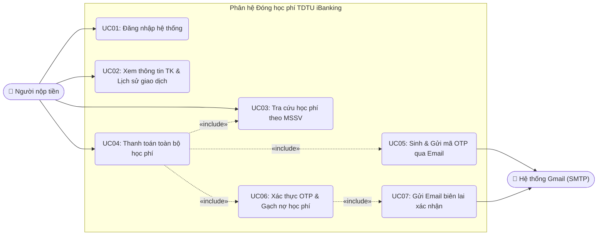
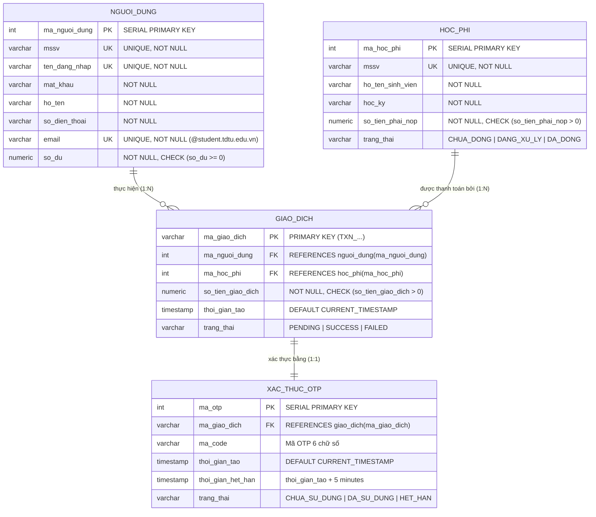
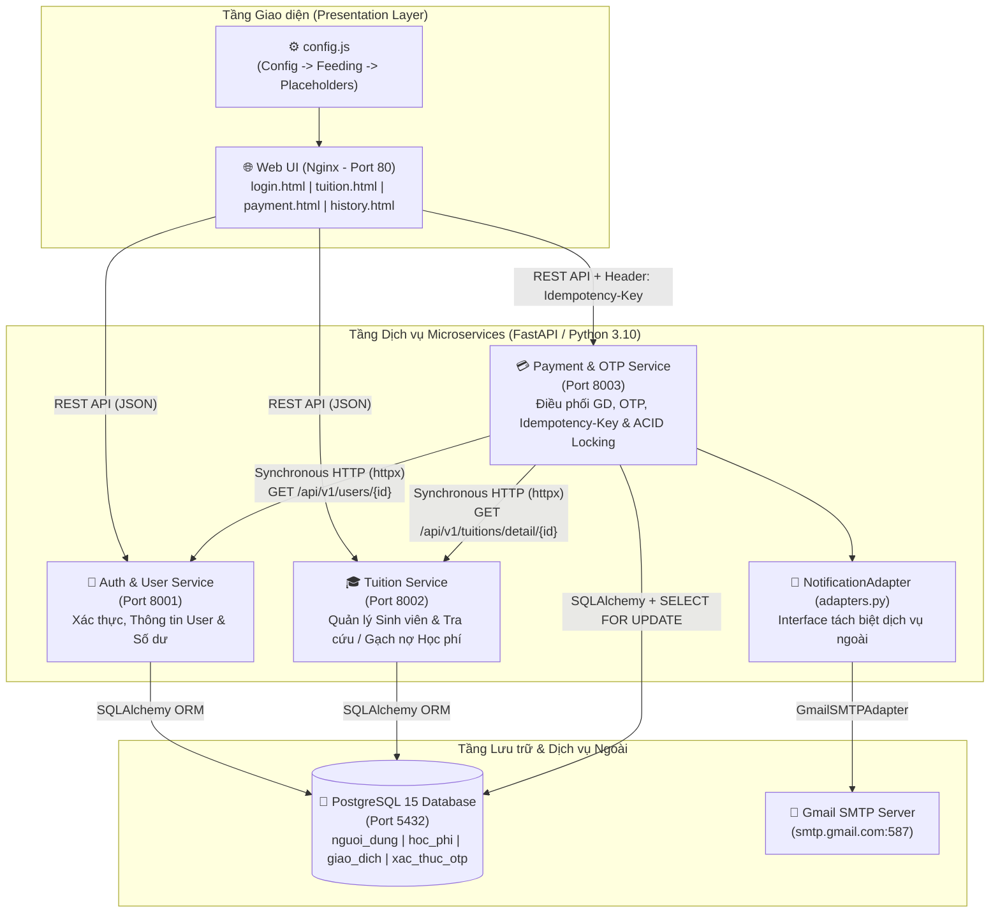
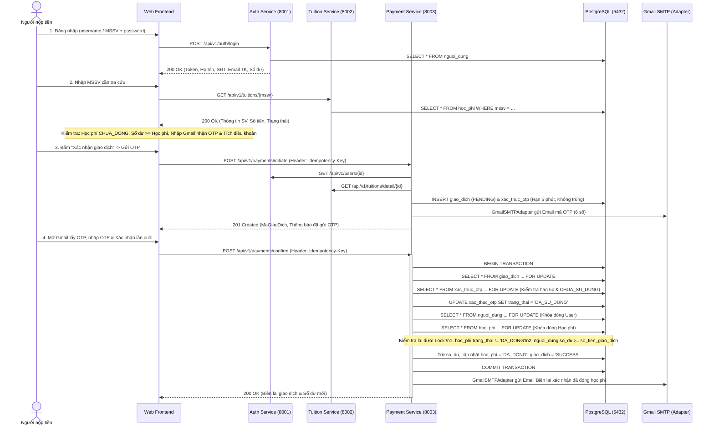

# 🏦 Phân Hệ Đóng Học Phí TDTU iBanking — Kiến Trúc Hướng Dịch Vụ (504070)

Dự án hiện thực ứng dụng mô phỏng **Phân hệ Thanh toán Học phí Sinh viên TDTU** thuộc hệ thống **iBanking**, được thiết kế theo **Kiến trúc Microservices** kết hợp đầy đủ các kỹ thuật nâng cao: **ACID Transaction**, **Pessimistic Row-Level Locking (`SELECT ... FOR UPDATE`)**, **Idempotency-Key (`IK`)**, **Webhook Callback**, **Adapter Pattern** cho dịch vụ gửi Gmail thật và **Config-driven Frontend**.

---

## 📌 Mục Lục
1. [Cấu trúc Thư mục Dự án](#-1-cấu-trúc-thư-mục-dự-án)
2. [Phân tích Nghiệp vụ & Lược đồ UML (Use Case & ERD)](#-2-phân-tích-nghiệp-vụ--lược-đồ-uml-tiêu-chí-1)
3. [Kiến trúc Microservices, Adapter Pattern & Config-driven UI](#-3-kiến-trúc-microservices-adapter-pattern--config-driven-ui-tiêu-chí-2)
4. [Thiết kế REST API & Idempotency-Key](#-4-thiết-kế-rest-api--idempotency-key-tiêu-chí-3)
5. [Thiết kế Cơ sở Dữ liệu & Dữ liệu Mẫu (Mock Data)](#-5-thiết-kế-cơ-sở-dữ-liệu--dữ-liệu-mẫu-tiêu-chí-4)
6. [Luồng Nghiệp vụ Thanh toán, OTP & Giải pháp Concurrency](#-6-luồng-nghiệp-vụ-thanh-toán-otp--giải-pháp-concurrency-tiêu-chí-5--6)
7. [Hướng dẫn Cài đặt & Khởi chạy Hệ thống (1 lệnh Docker)](#-7-hướng-dẫn-cài-đặt--khởi-chạy-hệ-thống-tiêu-chí-7--8)
8. [Kịch bản Demo Chi tiết trước Giảng viên](#-8-kịch-bản-demo-chi-tiết-trước-giảng-viên)

---

## 📁 1. Cấu trúc Thư mục Dự án

```text
Midterm-Kien-Truc-HDV/
├── backend/
│   ├── auth_service/               # Microservice 1: Xác thực, quản lý người dùng & số dư (Port 8001)
│   │   ├── Dockerfile
│   │   ├── main.py
│   │   └── requirements.txt
│   ├── tuition_service/            # Microservice 2: Quản lý sinh viên & tra cứu/gạch nợ học phí (Port 8002)
│   │   ├── Dockerfile
│   │   ├── main.py
│   │   └── requirements.txt
│   └── payment_service/            # Microservice 3: Điều phối thanh toán, OTP, Locking & Idempotency (Port 8003)
│       ├── Dockerfile
│       ├── adapters.py             # Adapter Pattern kết nối dịch vụ ngoài (GmailSMTPAdapter / ConsoleMailAdapter)
│       ├── main.py
│       ├── requirements.txt
│       └── test_concurrency.py     # Bản sao script test chạy trực tiếp bên trong container
├── frontend/                       # Giao diện Web Application (Nginx - Port 80)
│   ├── config.js                   # Cấu hình tập trung (Config -> Feeding -> Placeholders -> UI)
│   ├── index.html                  # Trang điều hướng tự động
│   ├── login.html                  # Màn hình Đăng nhập
│   ├── tuition.html                # Màn hình Tra cứu học phí & Kiểm tra điều kiện thanh toán (3 nhóm a, b, c)
│   ├── payment.html                # Màn hình Xác thực OTP & Biên lai kết quả giao dịch
│   ├── history.html                # Màn hình Lịch sử giao dịch
│   └── style.css                   # Giao diện chuẩn TDTU iBanking
├── .env                            # Cấu hình tài khoản SMTP Gmail thật (App Password)
├── docker-compose.yml              # Đóng gói toàn bộ DB, 3 Microservices và Frontend
├── init.sql                        # Khởi tạo bảng PostgreSQL, Constraints & Dữ liệu mẫu
├── test_concurrency.py             # Kịch bản kiểm thử tự động Concurrency & Idempotency-Key
└── README.md                       # Tài liệu thiết kế, kiến trúc và hướng dẫn Demo
```

---

## 📊 2. Phân tích Nghiệp vụ & Lược đồ UML (Tiêu chí 1)

### 2.1. Use Case Diagram
- **Actor chính**: **Người nộp tiền** (Chủ tài khoản iBanking, có thể tự đóng học phí cho chính mình hoặc đóng hộ cho sinh viên TDTU khác).
- **Hệ thống ngoài (External Actor)**: **Dịch vụ Email (Gmail SMTP)** nhận yêu cầu qua tầng Adapter để gửi mã OTP và gửi biên lai xác nhận đã đóng học phí.



### 2.2. Entity Relationship Diagram (ERD)



---

## 🏗️ 3. Kiến trúc Microservices, Adapter Pattern & Config-driven UI (Tiêu chí 2)

### 3.1. Microservices Architecture Diagram



### 3.2. Giải thích Thiết kế Kiến trúc
1. **Phân rã 3 Microservices độc lập**:
   - **`auth-service` (`Port 8001`)**: Quản lý xác thực đăng nhập (`username` hoặc `MSSV`), thông tin cá nhân người nộp tiền (`Họ tên`, `SĐT`, `Email tài khoản`, `Số dư khả dụng`).
   - **`tuition-service` (`Port 8002`)**: Quản lý thông tin sinh viên và khoản nợ học phí theo `MSSV`, hỗ trợ tra cứu và cập nhật trạng thái `DA_DONG`.
   - **`payment-service` (`Port 8003`)**: Đóng vai trò **Orchestrator** điều phối giao dịch, gọi HTTP sang `auth-service` và `tuition-service`, quản lý mã OTP, xử lý khóa dòng (`SELECT ... FOR UPDATE`) và kiểm soát `Idempotency-Key`.
2. **Áp dụng Adapter Pattern ([`backend/payment_service/adapters.py`](file:///d:/Visual_Studio_Code/SOA/Midterm-Kien-Truc-HDV/backend/payment_service/adapters.py))**:
   - Tách biệt hoàn toàn logic nghiệp vụ của `Payment Service` khỏi nhà cung cấp dịch vụ bên ngoài thông qua lớp trừu tượng `NotificationAdapter` (`GmailSMTPAdapter` và `ConsoleMailAdapter`). Khi cần mở rộng sang cổng thông báo khác (Zalo, SMS, SendGrid), chỉ cần bổ sung Concrete Adapter mới mà không sửa code nghiệp vụ.
3. **Áp dụng Config-driven UI ([`frontend/config.js`](file:///d:/Visual_Studio_Code/SOA/Midterm-Kien-Truc-HDV/frontend/config.js))**:
   - Tập trung cấu hình địa chỉ các Microservices, placeholders và hàm sinh `Idempotency-Key` tại một file cấu hình duy nhất để cấp dữ liệu (`feeding`) cho các trang giao diện.

---

## 🔌 4. Thiết kế REST API & Idempotency-Key (Tiêu chí 3)

### 4.1. Auth & User Service (`http://localhost:8001`)

| HTTP Method | URI | Mô tả chức năng | Request Body / Header | HTTP Status Codes |
| :--- | :--- | :--- | :--- | :--- |
| `POST` | `/api/v1/auth/login` | Đăng nhập bằng `username` hoặc `MSSV` | `{"username": "khiem123", "password": "123456"}` | `200 OK`, `401 Unauthorized` |
| `GET` | `/api/v1/auth/validate` | Kiểm tra tính hợp lệ của Bearer Token | Header: `Authorization: Bearer <token>` | `200 OK`, `401 Unauthorized` |
| `GET` | `/api/v1/users/me` | Lấy thông tin người nộp tiền đang đăng nhập | Header: `Authorization: Bearer <token>` | `200 OK`, `401 Unauthorized` |
| `GET` | `/api/v1/users/{user_id}` | API nội bộ lấy thông tin & số dư theo ID | Path param: `user_id` | `200 OK`, `404 Not Found` |
| `POST` | `/api/v1/users/{user_id}/deduct-balance` | API nội bộ trừ số dư (có `with_for_update`) | `{"amount": 5300000}` | `200 OK`, `400 Bad Request`, `404 Not Found` |

### 4.2. Tuition Service (`http://localhost:8002`)

| HTTP Method | URI | Mô tả chức năng | Request Param | HTTP Status Codes |
| :--- | :--- | :--- | :--- | :--- |
| `GET` | `/api/v1/tuitions` | Lấy danh sách toàn bộ học phí sinh viên | None | `200 OK` |
| `GET` | `/api/v1/tuitions/{mssv}` | Tra cứu thông tin học phí theo MSSV | Path param: `mssv` | `200 OK`, `404 Not Found` |
| `GET` | `/api/v1/tuitions/detail/{ma_hoc_phi}` | API nội bộ lấy học phí theo ID | Path param: `ma_hoc_phi` | `200 OK`, `404 Not Found` |
| `POST` | `/api/v1/tuitions/{ma_hoc_phi}/pay` | API nội bộ gạch nợ học phí sang `DA_DONG` | Path param: `ma_hoc_phi` | `200 OK`, `400 Bad Request`, `404 Not Found` |

### 4.3. Payment Service (`http://localhost:8003`)

| HTTP Method | URI | Mô tả chức năng | Request Body & Header | HTTP Status Codes |
| :--- | :--- | :--- | :--- | :--- |
| `POST` | `/api/v1/payments/initiate` | Khởi tạo giao dịch & gửi OTP qua Gmail | Header: `Idempotency-Key` (Optional)<br>Body: `{"MaNguoiDung": 1, "MaHocPhi": 1, "email": "...@gmail.com"}` | `201 Created`, `400 Bad Request`, `404 Not Found` |
| `POST` | `/api/v1/payments/confirm` | Xác thực OTP, trừ tiền, gạch nợ & gửi mail biên lai | Header: `Idempotency-Key` (Optional)<br>Body: `{"MaGiaoDich": "TXN_...", "otp": "123456", "email": "...@gmail.com"}` | `200 OK`, `400 Bad Request`, `404 Not Found` |
| `POST` | `/api/v1/payments/webhook/callback` | Nhận Webhook Callback trạng thái giao dịch (chống xử lý trùng bằng `Idempotency-Key`) | Header: `Idempotency-Key`<br>Body: `{"MaGiaoDich": "TXN_...", "event_type": "PAYMENT_CONFIRMED"}` | `200 OK`, `404 Not Found` |
| `GET` | `/api/v1/payments/history/{user_id}` | Lấy lịch sử giao dịch của người dùng | Path param: `user_id` | `200 OK` |
| `POST` | `/api/v1/payments/demo/reset` | Khôi phục dữ liệu mẫu về ban đầu để Demo lại | None | `200 OK` |

---

## 🗄️ 5. Thiết kế Cơ sở Dữ liệu & Dữ liệu Mẫu (Tiêu chí 4)

File [`init.sql`](file:///d:/Visual_Studio_Code/SOA/Midterm-Kien-Truc-HDV/init.sql) thiết lập các bảng PostgreSQL với đầy đủ ràng buộc toàn vẹn (**Constraints**):
- `nguoi_dung`: `mssv UNIQUE`, `ten_dang_nhap UNIQUE`, `email UNIQUE`, `CHECK (so_du >= 0)` (Chặn âm số dư ngay tại tầng CSDL).
- `hoc_phi`: `mssv UNIQUE`, `CHECK (so_tien_phai_nop > 0)`, `CHECK (trang_thai IN ('CHUA_DONG', 'DANG_XU_LY', 'DA_DONG'))`.
- `giao_dich`: Khóa ngoại tham chiếu `nguoi_dung` và `hoc_phi`, `CHECK (so_tien_giao_dich > 0)`.
- `xac_thuc_otp`: Khóa ngoại `REFERENCES giao_dich(ma_giao_dich) ON DELETE CASCADE`.

### Dữ liệu Mẫu (Mock Data) có sẵn trong Database:

**1. Bảng Người dùng (`nguoi_dung`):**
| Mã User | MSSV | Tên đăng nhập | Mật khẩu | Họ và tên | Số điện thoại | Email tài khoản | Số dư khả dụng |
| :---: | :--- | :--- | :--- | :--- | :--- | :--- | :--- |
| `1` | `524K0006` | `khiem123` | `123456` | Thân Vũ Gia Khiêm | `0901111111` | `524K0006@student.tdtu.edu.vn` | **10,000,000 VNĐ** |
| `2` | `524K0011` | `phuc123` | `123456` | Nguyễn Gia Phúc | `0902222222` | `524K0011@student.tdtu.edu.vn` | **10,000,000 VNĐ** |
| `3` | `523V0005` | `nhi123` | `123456` | Hồng Bảo Nhi | `0903333333` | `523V0005@student.tdtu.edu.vn` | **10,000,000 VNĐ** |
| `4` | `524V0007` | `nhu123` | `123456` | Phan Nguyễn Thảo Như | `0904444444` | `524V0007@student.tdtu.edu.vn` | **10,000,000 VNĐ** |

**2. Bảng Học phí (`hoc_phi`):**
| Mã HP | MSSV | Họ và tên sinh viên | Học kỳ | Số tiền phải nộp | Trạng thái ban đầu |
| :---: | :--- | :--- | :--- | :--- | :--- |
| `1` | `524K0011` | Nguyễn Gia Phúc | `HK1-2026-2027` | **5,300,000 VNĐ** | `CHUA_DONG` |
| `2` | `523V0005` | Hồng Bảo Nhi | `HK1-2026-2027` | **5,300,000 VNĐ** | `CHUA_DONG` |
| `3` | `524K0006` | Thân Vũ Gia Khiêm | `HK1-2026-2027` | **5,300,000 VNĐ** | `DA_DONG` (Đã đóng) |
| `4` | `524V0007` | Phan Nguyễn Thảo Như | `HK1-2026-2027` | **5,300,000 VNĐ** | `CHUA_DONG` |

---

## 🔒 6. Luồng Nghiệp vụ Thanh toán, OTP & Giải pháp Concurrency (Tiêu chí 5 & 6)

### 6.1. Sequence Diagram Luồng Thanh toán & Pessimistic Locking



### 6.2. Cơ chế Xử lý 3 Bài toán Đồng thời & Trùng lặp (Concurrency & Idempotency)
1. **Tình huống 1 — Nhiều giao dịch đồng thời trên cùng 1 tài khoản (Chống âm số dư)**:
   - Tài khoản `phuc123` có số dư `10,000,000 VNĐ`, mở 2 giao dịch đóng cho 2 MSSV `524K0011` (`5,300,000 VNĐ`) và `523V0005` (`5,300,000 VNĐ`). Tổng 2 khoản là `10,600,000 VNĐ > 10,000,000 VNĐ`.
   - Khi xác nhận OTP đồng thời, lệnh `.with_for_update()` (`SELECT ... FOR UPDATE`) khóa độc quyền dòng `nguoi_dung`. Giao dịch 1 trừ tiền trước còn `4,700,000 VNĐ`. Giao dịch 2 vào sau đọc lại số dư `4,700,000 < 5,300,000` nên lập tức bị từ chối (`400 Bad Request`, lưu trạng thái `FAILED`), đảm bảo không bao giờ âm tiền.
2. **Tình huống 2 — Nhiều tài khoản cùng thanh toán 1 khoản học phí (Chống đóng trùng)**:
   - Hai tài khoản `khiem123` và `phuc123` cùng xác nhận OTP đóng học phí cho MSSV `524K0011` (`5,300,000 VNĐ`) tại cùng một thời điểm.
   - Lệnh `.with_for_update()` khóa độc quyền dòng `hoc_phi`. Người thứ nhất cập nhật `trang_thai = 'DA_DONG'` và `COMMIT`. Người thứ hai đọc lại thấy `trang_thai == 'DA_DONG'` nên bị từ chối ngay (`400 Bad Request`) và giữ nguyên số dư.
3. **Tình huống 3 — Chống gửi lặp Request với `Idempotency-Key (IK)`**:
   - Khi Client hoặc Webhook gửi lặp lại request có cùng Header `Idempotency-Key`, hệ thống trả về ngay kết quả đã lưu trong `IDEMPOTENCY_STORE` (`idempotent_replay = True`) mà không tạo giao dịch mới hay trừ tiền lần 2.

---

## 🚀 7. Hướng dẫn Cài đặt & Khởi chạy Hệ thống (Tiêu chí 7 & 8)

### 7.1. Yêu cầu Hệ thống
- Đã cài đặt và bật **Docker Desktop**.

### 7.2. Khởi chạy toàn bộ hệ thống bằng 1 lệnh duy nhất
Mở Terminal tại thư mục gốc của dự án và chạy:

```bash
docker-compose up --build -d
```

> **Lưu ý khi muốn làm mới hoàn toàn Database từ file `init.sql`:**
> ```bash
> docker-compose down -v
> docker-compose up --build -d
> ```

### 7.3. Danh sách Địa chỉ Truy cập sau khi Khởi chạy
- 🌐 **Giao diện Web Application (Frontend)**: [http://localhost](http://localhost) (hoặc [http://localhost/login.html](http://localhost/login.html))
- 📘 **Swagger API Docs — Auth Service**: [http://localhost:8001/docs](http://localhost:8001/docs)
- 📘 **Swagger API Docs — Tuition Service**: [http://localhost:8002/docs](http://localhost:8002/docs)
- 📘 **Swagger API Docs — Payment Service**: [http://localhost:8003/docs](http://localhost:8003/docs)

---

## 🎬 8. Kịch bản Demo Chi tiết trước Giảng viên

### Phần 1: Demo Luồng Nghiệp vụ Chính trên Giao diện Web (`http://localhost`)
1. **Đăng nhập**:
   - Truy cập [http://localhost](http://localhost).
   - Nhập tài khoản: `khiem123` (hoặc MSSV `524K0006`) | Mật khẩu: `123456` $\rightarrow$ Bấm **Đăng nhập**.
   - **Điểm nhấn thuyết trình**: Chỉ cho giảng viên thấy mục **a. Thông tin người nộp tiền** (Họ tên `Thân Vũ Gia Khiêm`, SĐT `0901111111`, Email `524K0006@student.tdtu.edu.vn`) được lấy tự động từ tài khoản đăng nhập và bị khóa cứng (`disabled`) đúng yêu cầu đề bài. Số dư khả dụng hiện `10.000.000 VNĐ`.
2. **Tra cứu học phí & Kiểm tra điều kiện chặn (Validation)**:
   - **Test 1 (MSSV không tồn tại)**: Nhập `524K9999` $\rightarrow$ Báo lỗi `404 Not Found` (`"Không tìm thấy sinh viên với MSSV '524K9999'"`), nút **Xác nhận giao dịch** bị khóa.
   - **Test 2 (Học phí đã đóng)**: Nhập `524K0006` $\rightarrow$ Hiện trạng thái **`ĐÃ THANH TOÁN`**, báo lỗi đỏ không cho đóng lại, nút **Xác nhận giao dịch** vẫn bị khóa.
   - **Test 3 (Học phí hợp lệ chưa đóng)**: Nhập `524K0011` (`Nguyễn Gia Phúc` - `5.300.000 VNĐ` - `CHƯA THANH TOÁN`).
3. **Nhập Gmail nhận OTP & Đồng ý Điều khoản**:
   - Tại mục **c. Thông tin thanh toán**, nhập địa chỉ Gmail thật vào ô **Địa chỉ Gmail nhận mã OTP** (ví dụ: `giaphucnguyen36573@gmail.com`).
   - Tích chọn ô **"Tôi đã đọc và đồng ý với các thỏa thuận và điều khoản của hệ thống"** $\rightarrow$ Nút **Xác nhận giao dịch** lập tức mở khóa.
4. **Nhận OTP qua Gmail & Hoàn tất Thanh toán**:
   - Bấm **Xác nhận giao dịch** $\rightarrow$ Kiểm tra thông tin tóm tắt $\rightarrow$ Bấm **Gửi mã OTP qua Email & Tiếp tục**.
   - Mở hộp thư **Gmail** vừa nhập: Nhận email tiêu đề `[TDTU iBanking] Mã xác thực OTP giao dịch TXN_...` chứa mã 6 chữ số.
   - Nhập mã OTP vào màn hình Web $\rightarrow$ Bấm **Xác nhận thanh toán lần cuối**.
   - **Kết quả**:
     - Màn hình hiển thị **Biên lai Thanh toán Học phí Thành công**, số dư giảm từ `10.000.000 VNĐ` xuống **`4.700.000 VNĐ`**.
     - Hộp thư **Gmail** lập tức nhận được **Email thứ 2 (Biên lai xác nhận đã đóng học phí thành công - màu xanh lá)**.
     - Bấm **Xem Lịch sử giao dịch** thấy giao dịch được lưu trạng thái `SUCCESS`.

---

### Phần 2: Kiểm tra Dữ liệu Thật trong PostgreSQL ngay trên Terminal
Sau khi đóng học phí trên Web xong, chạy lệnh sau trong Terminal để chứng minh cho giảng viên thấy dữ liệu trong PostgreSQL đã cập nhật thật (`trang_thai = DA_DONG`, `so_du` đã trừ):

```bash
docker exec -it ibanking-db psql -U root -d ibanking -c "SELECT * FROM hoc_phi; SELECT ma_nguoi_dung, mssv, ten_dang_nhap, so_du FROM nguoi_dung;"
```

---

### Phần 3: Chạy Kịch bản Kiểm thử Tự động Concurrency & Idempotency-Key (Lấy điểm 9.5 – 10.0)
Gõ lệnh sau vào Terminal để bắn đa luồng kiểm chứng trực tiếp trước mặt giảng viên:

```bash
docker exec -it ibanking-payment-service python test_concurrency.py
```

Kịch bản sẽ tự động chạy và in kết quả kiểm chứng **3 tình huống quan trọng nhất**:
1. **Tình huống 1 (Chống âm số dư khi 1 tài khoản chạy nhiều giao dịch đồng thời)**:
   - Tài khoản `phuc123` (`10,000,000 VNĐ`) bắn đồng thời 2 xác nhận OTP cho 2 khoản học phí `524K0011` (`5,300,000 VNĐ`) và `523V0005` (`5,300,000 VNĐ`).
   - **Kết quả**: Đúng 1 giao dịch `200 OK (SUCCESS)` (số dư còn `4,700,000 VNĐ`), giao dịch thứ 2 bị khóa dòng chặn lại và trả về `400 Bad Request` (`"Số dư khả dụng không đủ"`).
2. **Tình huống 2 (Chống thanh toán trùng khi nhiều tài khoản đóng cùng 1 MSSV)**:
   - Hai tài khoản `khiem123` và `phuc123` bắn đồng thời 2 xác nhận OTP cho cùng MSSV `524K0011` (`5,300,000 VNĐ`).
   - **Kết quả**: Đúng 1 người đóng thành công (`200 OK`), người còn lại nhận `400 Bad Request` (`"Khoản học phí này đã được thanh toán thành công bởi một giao dịch khác!"`) và không bị trừ tiền.
3. **Tình huống 3 (Chống xử lý trùng lặp bằng `Idempotency-Key` & `Webhook Callback`)**:
   - Gửi lặp lại 2 request có cùng Header `Idempotency-Key: IK_DEMO_TEST_001` $\rightarrow$ Hệ thống nhận diện và trả về lại đúng kết quả cũ (`idempotent_replay = True`), không sinh giao dịch mới.
