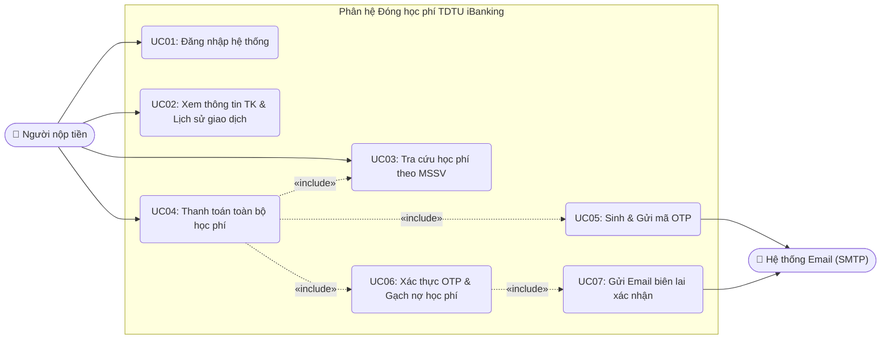
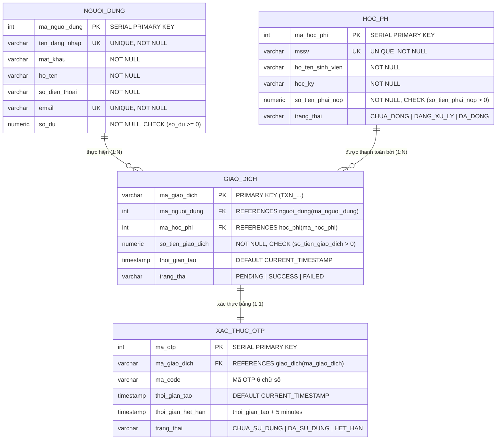
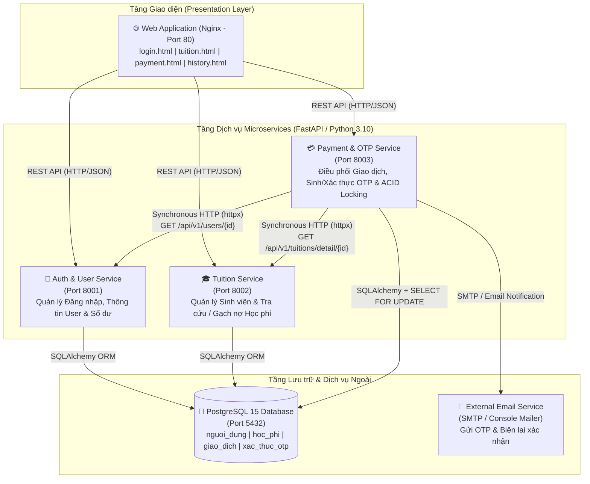
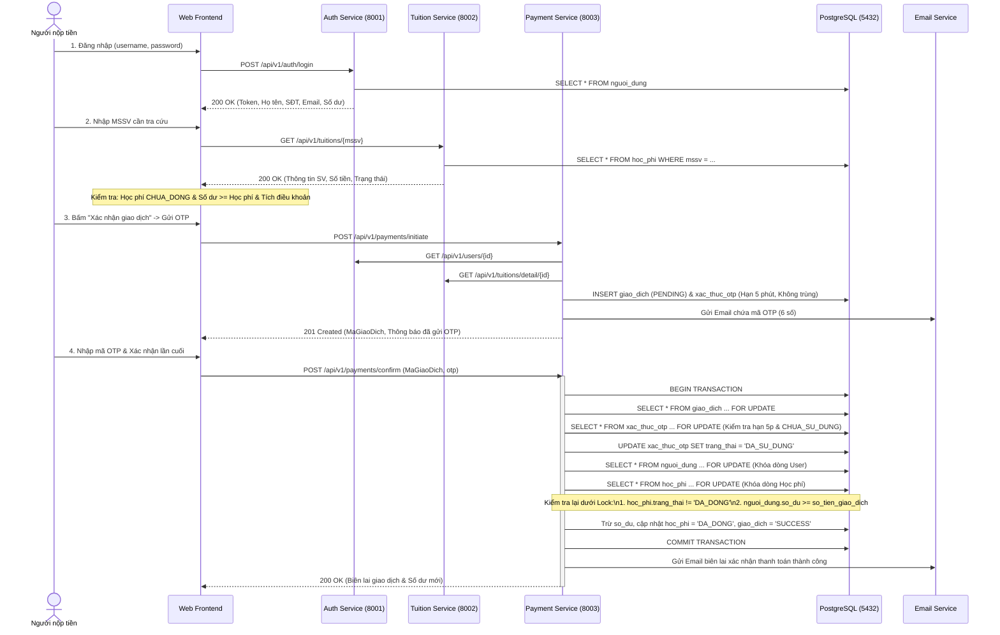

# Phân Hệ Đóng Học Phí TDTU iBanking - Kiến Trúc Hướng Dịch Vụ (504070)

Dự án mô phỏng phân hệ **Thanh toán học phí sinh viên TDTU** trên ứng dụng **iBanking**, được thiết kế theo **Kiến trúc Microservices** kết hợp cơ chế đảm bảo tính nhất quán dữ liệu (**ACID Transaction & Pessimistic Locking**) cho các giao dịch tài chính đồng thời.

---

## 👥 Thông tin Nhóm thực hiện & Phân công

| Thành viên | Vai trò | Hạng mục phụ trách theo Rubric |
| :--- | :--- | :--- |
| **Hồng Bảo Nhi (POYI)** | Kiến trúc sư Hệ thống & Xử lý Giao dịch | Mục 2 (Kiến trúc Microservices - 1.5đ), Mục 6 (Transaction & Concurrency - 1.5đ) |
| **Thân Vũ Gia Khiêm** | Chuyên gia Dữ liệu & Dịch vụ Nền tảng | Mục 1 (Phân tích nghiệp vụ & UML - 1.0đ), Mục 3 (Thiết kế REST API - 1.0đ), Mục 4 (Database & Persistence - 1.0đ) |
| **Nguyễn Gia Phúc** | Lập trình Giao diện & Triển khai | Mục 5 (Payment Workflow & OTP - 2.0đ), Mục 7 (UI & Integration - 0.5đ), Mục 8 (Documentation, Docker & Demo - 1.5đ) |

---

## 1. Phân tích Nghiệp vụ & Lược đồ UML (Tiêu chí 1)

### 1.1. Phân tích Nghiệp vụ
- **Actor chính**: **Người nộp tiền** (Chủ tài khoản iBanking — có thể là chính sinh viên hoặc người thân đóng hộ học phí cho sinh viên TDTU).
- **Hệ thống ngoài (External Actor)**: **Email Server (SMTP)** nhận yêu cầu gửi mã xác thực OTP và gửi biên lai xác nhận thanh toán thành công.
- **Các Use Case chính**:
  1. **Đăng nhập (`UC01`)**: Xác thực bằng `username` và `password`, trả về phiên đăng nhập và thông tin tài khoản.
  2. **Xem thông tin tài khoản & Lịch sử giao dịch (`UC02`)**: Xem Họ tên, SĐT, Email, Số dư khả dụng và lịch sử các giao dịch đã thực hiện.
  3. **Tra cứu học phí theo MSSV (`UC03`)**: Nhập MSSV để tra cứu tự động Họ tên sinh viên, Học kỳ, Số tiền cần thanh toán và Trạng thái học phí.
  4. **Khởi tạo thanh toán học phí (`UC04`)**: Kiểm tra điều kiện hợp lệ (học phí tồn tại, chưa đóng, số dư khả dụng >= số tiền học phí, đồng ý điều khoản), tạo giao dịch `PENDING` và yêu cầu sinh mã OTP (`<<include>>`).
  5. **Xác thực giao dịch bằng OTP (`UC05`)**: Nhập mã OTP nhận qua Email (gắn với mã giao dịch cụ thể, không trùng với OTP đang có hiệu lực khác, thời hạn tối đa 5 phút, chỉ dùng 1 lần) để hoàn tất trừ tiền, gạch nợ học phí và nhận email xác nhận (`<<include>>`).

### 1.2. Use Case Diagram



### 1.3. Entity Relationship Diagram (ERD)



---

## 2. Thiết kế Kiến trúc Microservices (Tiêu chí 2)

### 2.1. Microservices Architecture Diagram



### 2.2. Phân rã Trách nhiệm & Cơ chế Giao tiếp
1. **`auth-service` (Port `8001`)**:
   - **Trách nhiệm**: Xác thực thông tin đăng nhập (`username`/`password`), cấp và kiểm tra Bearer Token, cung cấp thông tin cá nhân người nộp tiền (`Họ và tên`, `Số điện thoại`, `Email`, `Số dư khả dụng`) và hỗ trợ cập nhật số dư an toàn.
2. **`tuition-service` (Port `8002`)**:
   - **Trách nhiệm**: Quản lý danh mục khoản thu học phí của sinh viên TDTU, cung cấp API tra cứu công khai theo `MSSV` và API nội bộ truy vấn chi tiết theo `MaHocPhi` hoặc cập nhật trạng thái `DA_DONG`.
3. **`payment-service` (Port `8003`)**:
   - **Trách nhiệm**: Đóng vai trò **Orchestrator (Bộ điều phối giao dịch)**:
     - Giao tiếp đồng bộ (**Synchronous REST via `httpx`**) sang `auth-service` và `tuition-service` để kiểm tra chéo điều kiện giao dịch khi khởi tạo.
     - Quản lý vòng đời mã xác thực **OTP** (gắn chặt với `ma_giao_dich`, kiểm tra chống trùng với mọi OTP đang còn hiệu lực, thời hạn đúng 5 phút, vô hiệu hóa ngay sau 1 lần dùng).
     - Thực thi **ACID Transaction & Pessimistic Locking (`SELECT ... FOR UPDATE`)** khi xác nhận OTP để trừ tiền người dùng, gạch nợ học phí, lưu lịch sử giao dịch và gửi Email xác nhận.

---

## 3. Thiết kế REST API (Tiêu chí 3)

### 3.1. Auth & User Service (`http://localhost:8001`)

| HTTP Method | URI | Mô tả chức năng | Request Body / Header | Response Model (JSON) | HTTP Status Codes |
| :--- | :--- | :--- | :--- | :--- | :--- |
| `POST` | `/api/v1/auth/login` | Đăng nhập bằng username & password | `{"username": "phuc123", "password": "123456"}` | `{"access_token": "...", "MaNguoiDung": 2, "HoTen": "...", "SoDienThoai": "...", "Email": "...", "SoDuKhaDung": 10000000}` | `200 OK`, `401 Unauthorized`, `422 Unprocessable Entity` |
| `GET` | `/api/v1/auth/validate` | Kiểm tra tính hợp lệ của Bearer Token | Header: `Authorization: Bearer <token>` | `{"valid": true, "user_id": 2, "full_name": "...", "available_balance": 10000000}` | `200 OK`, `401 Unauthorized` |
| `GET` | `/api/v1/users/me` | Lấy thông tin người nộp tiền đang đăng nhập | Header: `Authorization: Bearer <token>` | `{"MaNguoiDung": 2, "HoTen": "...", "SoDienThoai": "...", "Email": "...", "SoDuKhaDung": 10000000}` | `200 OK`, `401 Unauthorized` |
| `GET` | `/api/v1/users/{user_id}` | API nội bộ lấy thông tin & số dư theo ID | Path param: `user_id` | `{"MaNguoiDung": 2, "full_name": "...", "phone": "...", "email": "...", "available_balance": 10000000}` | `200 OK`, `404 Not Found` |
| `POST` | `/api/v1/users/{user_id}/deduct-balance` | API nội bộ trừ số dư (có khóa dòng) | `{"amount": 7500000}` | `{"status": "SUCCESS", "MaNguoiDung": 2, "new_balance": 2500000}` | `200 OK`, `400 Bad Request`, `404 Not Found` |

### 3.2. Tuition Service (`http://localhost:8002`)

| HTTP Method | URI | Mô tả chức năng | Request Body / Param | Response Model (JSON) | HTTP Status Codes |
| :--- | :--- | :--- | :--- | :--- | :--- |
| `GET` | `/api/v1/tuitions` | Lấy danh sách toàn bộ học phí sinh viên | None | `[{"MaHocPhi": 1, "MSSV": "524K0001", "HoTen": "...", "HocKy": "...", "SoTienPhaiNop": 7500000, "TrangThai": "CHUA_DONG"}]` | `200 OK` |
| `GET` | `/api/v1/tuitions/{mssv}` | Tra cứu thông tin học phí theo MSSV | Path param: `mssv` | `{"MaHocPhi": 1, "MSSV": "524K0001", "HoTen": "Nguyễn Gia Phúc", "HocKy": "HK1-2026-2027", "SoTienPhaiNop": 7500000, "TrangThai": "CHUA_DONG"}` | `200 OK`, `404 Not Found` |
| `GET` | `/api/v1/tuitions/detail/{ma_hoc_phi}` | API nội bộ lấy học phí theo ID | Path param: `ma_hoc_phi` | `{"MaHocPhi": 1, "MSSV": "524K0001", "HoTen": "...", "SoTienPhaiNop": 7500000, "TrangThai": "CHUA_DONG"}` | `200 OK`, `404 Not Found` |
| `POST` | `/api/v1/tuitions/{ma_hoc_phi}/pay` | API nội bộ gạch nợ học phí sang `DA_DONG` | Path param: `ma_hoc_phi` | `{"status": "SUCCESS", "MaHocPhi": 1, "TrangThai": "DA_DONG"}` | `200 OK`, `400 Bad Request`, `404 Not Found` |

### 3.3. Payment Service (`http://localhost:8003`)

| HTTP Method | URI | Mô tả chức năng | Request Body / Param | Response Model (JSON) | HTTP Status Codes |
| :--- | :--- | :--- | :--- | :--- | :--- |
| `POST` | `/api/v1/payments/initiate` | Khởi tạo giao dịch thanh toán & gửi OTP qua Email | `{"MaNguoiDung": 2, "MaHocPhi": 1}` | `{"transaction_id": "TXN_...", "MaGiaoDich": "TXN_...", "email": "...", "expires_in_seconds": 300, "otp_demo": "123456", "message": "..."}` | `201 Created`, `400 Bad Request`, `404 Not Found` |
| `POST` | `/api/v1/payments/confirm` | Xác thực OTP, trừ tiền, gạch nợ & gửi mail biên lai | `{"MaGiaoDich": "TXN_...", "otp": "123456"}` | `{"message": "...", "MaGiaoDich": "TXN_...", "status": "SUCCESS", "amount": 7500000, "new_balance": 2500000, "mssv": "524K0001"}` | `200 OK`, `400 Bad Request`, `404 Not Found` |
| `GET` | `/api/v1/payments/history/{user_id}` | Lấy lịch sử giao dịch của người dùng | Path param: `user_id` | `[{"MaGiaoDich": "TXN_...", "MSSV": "524K0001", "HoTenSinhVien": "...", "SoTienGiaoDich": 7500000, "NgayGiaoDich": "...", "TrangThai": "SUCCESS"}]` | `200 OK` |
| `POST` | `/api/v1/payments/demo/reset` | Khôi phục dữ liệu mẫu về ban đầu để test lại | None | `{"status": "SUCCESS", "message": "Đã khôi phục dữ liệu mẫu..."}` | `200 OK` |

---

## 4. Thiết kế Cơ sở Dữ liệu & Dữ liệu Mẫu (Tiêu chí 4)

File khởi tạo tự động [`init.sql`](file:///d:/Visual_Studio_Code/SOA/Midterm-Kien-Truc-HDV/init.sql) thiết lập các bảng với đầy đủ **Data Constraints**:
- `nguoi_dung`: `ten_dang_nhap UNIQUE`, `email UNIQUE`, `CHECK (so_du >= 0)` (Chống âm số dư ngay ở tầng CSDL).
- `hoc_phi`: `mssv UNIQUE`, `CHECK (so_tien_phai_nop > 0)`, `CHECK (trang_thai IN ('CHUA_DONG', 'DANG_XU_LY', 'DA_DONG'))`.
- `giao_dich`: Khóa ngoại tham chiếu chặt chẽ tới `nguoi_dung` và `hoc_phi`, `CHECK (so_tien_giao_dich > 0)`.
- `xac_thuc_otp`: Khóa ngoại tham chiếu `giao_dich(ma_giao_dich) ON DELETE CASCADE`.

### Dữ liệu mẫu (Mock Data) có sẵn khi khởi chạy:

**Bảng Người dùng (`nguoi_dung`):**
| MSSV | Username | Password | Họ và tên | Số điện thoại | Email (Theo MSSV) | Số dư khả dụng | Mục đích kiểm thử |
| :--- | :--- | :--- | :--- | :--- | :--- | :--- | :--- |
| `524K0006` | `khiem123` | `123456` | Thân Vũ Gia Khiêm | `0901111111` | `524K0006@student.tdtu.edu.vn` | **20,000,000 VNĐ** | Đủ thanh toán mọi khoản học phí |
| `524K0001` | `phuc123` | `123456` | Nguyễn Gia Phúc | `0902222222` | `524K0001@student.tdtu.edu.vn` | **10,000,000 VNĐ** | Đủ đóng 1 khoản (7.5tr/8tr), dùng để test **Concurrency chống âm số dư** khi đóng 2 khoản cùng lúc |
| `524K0005` | `nhi123` | `123456` | Hồng Bảo Nhi | `0903333333` | `524K0005@student.tdtu.edu.vn` | **2,000,000 VNĐ** | Dùng để test trường hợp **Không đủ số dư** với khoản 7.5tr, hoặc đóng khoản nhỏ 1.5tr |

**Bảng Học phí (`hoc_phi`):**
| MSSV | Họ và tên sinh viên | Học kỳ | Số tiền phải nộp | Trạng thái ban đầu |
| :--- | :--- | :--- | :--- | :--- |
| `524K0001` | Nguyễn Gia Phúc | `HK1-2026-2027` | **7,500,000 VNĐ** | `CHUA_DONG` |
| `524K0005` | Hồng Bảo Nhi | `HK1-2026-2027` | **8,000,000 VNĐ** | `CHUA_DONG` |
| `524K0006` | Thân Vũ Gia Khiêm | `HK1-2026-2027` | **8,500,000 VNĐ** | `DA_DONG` (Đã thanh toán) |
| `524K0008` | Trần Minh Tuấn | `HK1-2026-2027` | **1,500,000 VNĐ** | `CHUA_DONG` |
| `524K0009` | Lê Hoàng Nam | `HK1-2026-2027` | **15,000,000 VNĐ** | `CHUA_DONG` |

---

## 5. Luồng Nghiệp vụ Thanh toán & Xử lý Transaction / Concurrency (Tiêu chí 5 & 6)

### 5.1. Sequence Diagram Luồng Thanh toán & Khóa dòng (Pessimistic Locking)



### 5.2. Giải thích cơ chế xử lý 2 tình huống Concurrency (Race Condition)
Trong [`backend/payment_service/main.py`](file:///d:/Visual_Studio_Code/SOA/Midterm-Kien-Truc-HDV/backend/payment_service/main.py), hàm `confirm_payment` sử dụng cơ chế **Pessimistic Locking (`SELECT ... FOR UPDATE`)** của PostgreSQL thông qua SQLAlchemy `.with_for_update()`:

1. **Tình huống 1 — Nhiều giao dịch đồng thời trên cùng một tài khoản (Chống chi tiêu vượt số dư / âm tiền)**:
   - Giả sử tài khoản `phuc123` có số dư `10,000,000 VNĐ`, mở 2 tab khởi tạo 2 giao dịch đóng học phí `7,500,000 VNĐ` (`524K0001`) và `8,000,000 VNĐ` (`524K0005`).
   - Khi cả 2 giao dịch cùng gửi OTP xác nhận đồng thời, câu lệnh `db.query(UserModel).filter(...).with_for_update().first()` sẽ **khóa độc quyền (Row-level Exclusive Lock)** dòng dữ liệu của `phuc123` trong bảng `nguoi_dung`.
   - Giao dịch thứ nhất lấy được khóa trước, kiểm tra `10,000,000 >= 7,500,000`, trừ số dư còn `2,500,000 VNĐ` và `COMMIT`.
   - Ngay khi khóa được giải phóng, giao dịch thứ hai mới được đọc dòng `nguoi_dung` với số dư mới nhất là `2,500,000 VNĐ`. Do `2,500,000 < 8,000,000`, giao dịch thứ hai bị chuyển sang trạng thái `FAILED` và trả về mã lỗi `400 Bad Request` (`"Số dư khả dụng không đủ để thực hiện giao dịch!"`).

2. **Tình huống 2 — Nhiều tài khoản đồng thời thanh toán cùng một khoản học phí (Chống thanh toán trùng)**:
   - Giả sử `khiem123` và `phuc123` cùng tra cứu và khởi tạo thanh toán cho MSSV `524K0001` (`7,500,000 VNĐ`).
   - Khi cả 2 cùng bấm xác nhận OTP tại một thời điểm, câu lệnh `db.query(HocPhiModel).filter(...).with_for_update().first()` sẽ **khóa độc quyền dòng học phí** của `524K0001`.
   - Người thứ nhất giữ khóa trước, kiểm tra `trang_thai == 'CHUA_DONG'`, trừ tiền và cập nhật `trang_thai = 'DA_DONG'` rồi `COMMIT`.
   - Người thứ hai sau khi chờ khóa được nhả ra sẽ đọc lại trạng thái mới nhất của `hoc_phi` là `DA_DONG`, lập tức hệ thống từ chối giao dịch thứ hai (`400 Bad Request`: `"Khoản học phí này đã được thanh toán thành công bởi một giao dịch khác!"`), **không trừ tiền của người thứ hai** và lưu lịch sử giao dịch là `FAILED`.

---

## 6. Hướng dẫn Cài đặt, Khởi chạy & Kịch bản Demo (Tiêu chí 7 & 8)

### 6.1. Khởi chạy toàn bộ hệ thống bằng 1 lệnh duy nhất (Docker Compose)
Yêu cầu máy tính đã cài đặt **Docker Desktop**. Mở Terminal tại thư mục gốc của dự án và chạy:

```bash
docker-compose up --build -d
```

Sau khi các container khởi chạy (khoảng 5–10 giây):
- **Giao diện Web Application (Frontend)**: Truy cập [http://localhost](http://localhost) (hoặc [http://localhost/login.html](http://localhost/login.html))
- **Swagger UI - Auth Service**: [http://localhost:8001/docs](http://localhost:8001/docs)
- **Swagger UI - Tuition Service**: [http://localhost:8002/docs](http://localhost:8002/docs)
- **Swagger UI - Payment Service**: [http://localhost:8003/docs](http://localhost:8003/docs)

### 6.2. Kịch bản Demo Trực tiếp trước Giảng viên

#### Phần A: Demo Luồng giao dịch chuẩn trên Giao diện Web
1. Mở trình duyệt vào [http://localhost](http://localhost).
2. Chọn hoặc nhập tài khoản `khiem123` / mật khẩu `123456` (Số dư `20,000,000 VNĐ`).
3. Tại màn hình **Tra cứu & Thanh toán học phí**:
   - Quan sát nhóm **a. Thông tin người nộp tiền**: Họ tên, Số điện thoại, Email được lấy tự động từ tài khoản đăng nhập và bị khóa (`disabled`).
   - Nhập MSSV `524K0006` (Đã đóng) -> Hệ thống hiển thị trạng thái `ĐÃ THANH TOÁN` và khóa nút **Xác nhận giao dịch**.
   - Nhập MSSV `524K0001` (Chưa đóng - `7,500,000 VNĐ`) -> Tích chọn ô **"Tôi đã đọc và đồng ý với các thỏa thuận và điều khoản"** -> Nút **Xác nhận giao dịch** sáng lên.
4. Bấm **Xác nhận giao dịch** -> Bấm **Gửi mã OTP qua Email & Tiếp tục**.
5. Nhập mã OTP 6 chữ số (hiển thị trên hộp thư mô phỏng hoặc xem qua lệnh `docker logs ibanking-payment-service`) -> Bấm **Xác nhận thanh toán lần cuối**.
6. Quan sát biên lai thành công, kiểm tra số dư giảm từ `20,000,000 VNĐ` xuống `12,500,000 VNĐ`, và vào mục **Lịch sử GD** để kiểm tra.

#### Phần B: Chạy Script Kiểm thử Tự động Concurrency (Chứng minh 2 tình huống đồng thời)
Mở Terminal tại thư mục dự án và chạy:

```bash
python test_concurrency.py
```

Script [`test_concurrency.py`](file:///d:/Visual_Studio_Code/SOA/Midterm-Kien-Truc-HDV/test_concurrency.py) sẽ tự động dùng `ThreadPoolExecutor` bắn đồng thời các request vào hệ thống để kiểm chứng:
1. **Tình huống 1**: Tài khoản `phuc123` (`10,000,000 VNĐ`) bắn đồng thời 2 xác nhận OTP cho 2 khoản học phí `7,500,000 VNĐ` và `8,000,000 VNĐ` -> Chứng minh đúng 1 giao dịch `200 OK (SUCCESS)` và 1 giao dịch `400 Bad Request (FAILED)`, số dư không bao giờ âm.
2. **Tình huống 2**: Hai tài khoản `khiem123` và `phuc123` bắn đồng thời 2 xác nhận OTP cho cùng MSSV `524K0001` -> Chứng minh đúng 1 người thanh toán thành công, người còn lại bị từ chối và không bị trừ tiền oan.
